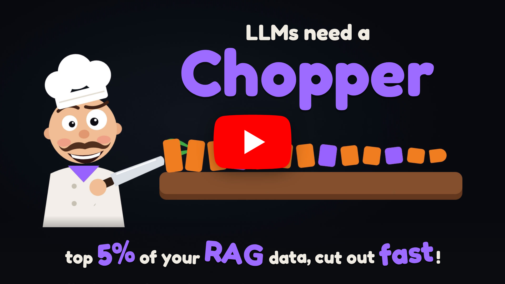
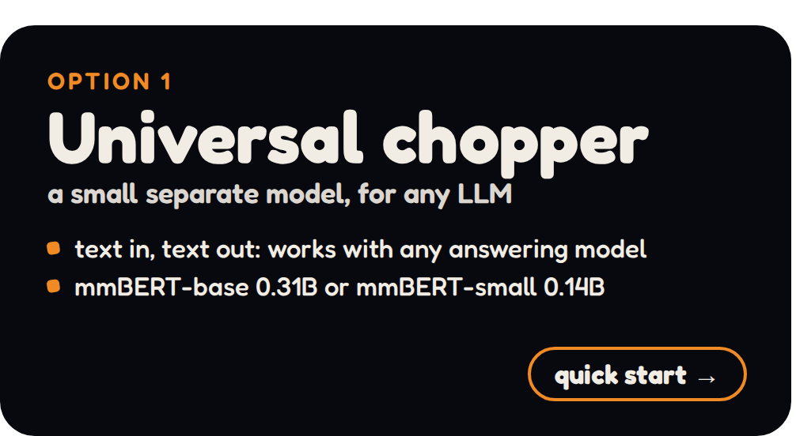
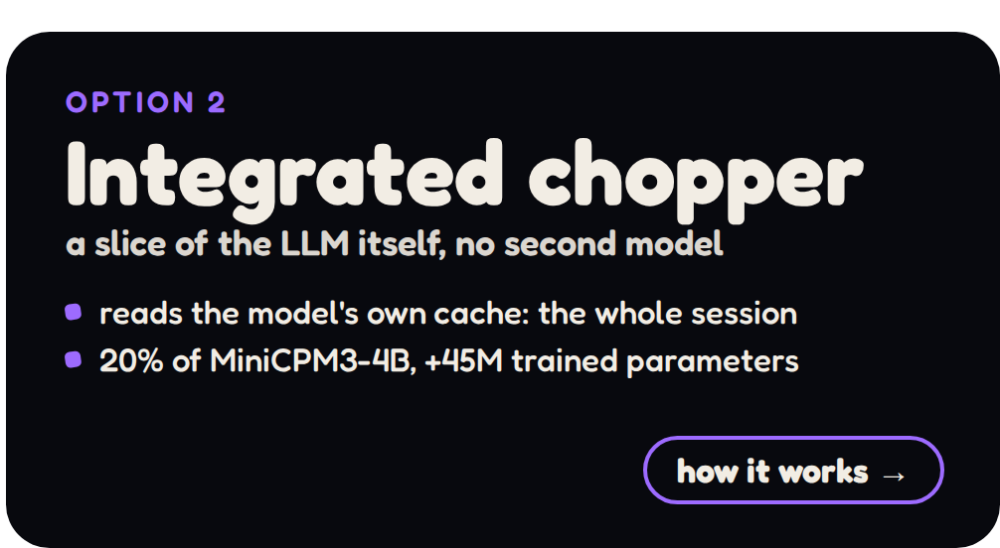
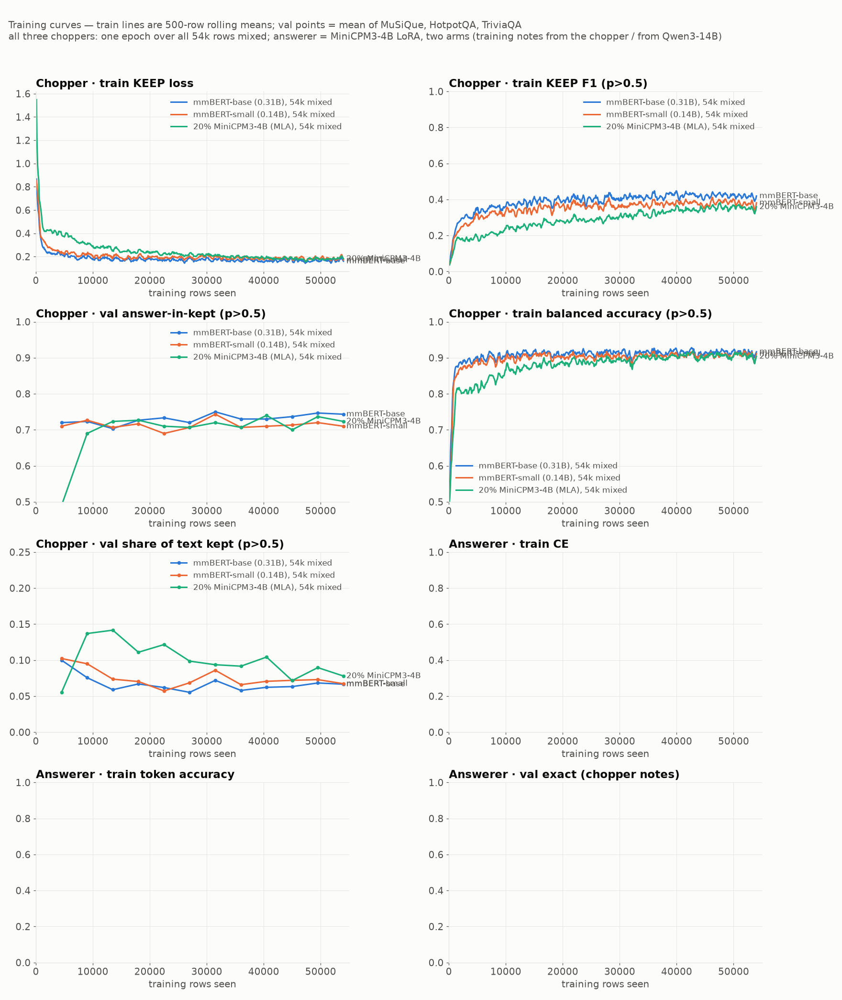

<p align="center">
  <a href="https://youtu.be/KMvmdXCEOJU"></a><br>
  <a href="#quick-start"></a>
  <a href="#a-host-with-latent-attention-minicpm3-4b"></a>
</p>

<p align="center"><em>70-second video: <a href="https://youtu.be/KMvmdXCEOJU">youtu.be/KMvmdXCEOJU</a> · also in this repo as <a href="media/chopper.mp4">media/chopper.mp4</a></em></p>

# Chopper: cut retrieved text down to the fragments that answer the question

> **DRAFT 2026-11-03.** Sections marked ⏳ describe parts that are planned or still training. Every number in
> **Results** was measured; nothing in it is projected.

> 💡 **Affordable technology.** Everything in this repository was built and trained on **one 24 GB GPU** (an RTX 3090
> at home): the datasets, the 14B fragment labels, every chopper. No cloud, no cluster.

## Clean your RAG inputs from spam tokens, and save your long work session

**The problem.** Standard RAG (retrieval-augmented generation) pastes whole retrieved passages into the model's
context, and they stay there. Typically ~95% of those tokens are irrelevant to the question. After a few retrieval
rounds, a long work session is mostly retrieval spam:
- it uses up the context window;
- it slows every following token;
- it buries the conversation the user actually cares about.

So a long session that needs many RAG lookups is not practical today.

**The fix.**
1. A small **chopper** model reads the retrieved passages first and cuts out only the fragments that matter
   (~3 × 35 tokens out of ~3,000).
2. The main model's context is then **rolled back** to the end of the conversation (its KV cache is cropped). The raw
   passages never stay in it.
3. Only the clean fragments are added, and the model either **answers** or writes **one follow-up search question**.

The context grows by ~100 tokens per lookup instead of ~3,000, so a session can carry dozens of lookups.

Why it matters:
- **A clean, long-lived context.** After each lookup only the useful fragments stay in the session. Plain RAG cannot
  take passages back out once they are in the context; rollback can.
- **Less compute.** The expensive model prefills ~100 tokens instead of ~3,000 per retrieval step.
- **Multi-hop retrieval works.** A written follow-up question retrieves the second hop that the first search missed.
  On MuSiQue, all-hops coverage goes from .62 to .87.

---

## Contents
1. [How it works](#how-it-works)
2. [What is in this repository](#what-is-in-this-repository)
3. [Quick start](#quick-start)
4. [Datasets](#datasets)
5. [Models](#models)
6. [Training: hardware, time, memory](#training-hardware-time-memory)
7. [Results](#results)
8. [The operator: double prefill, chopping, rollback, answer or search](#the-operator)
9. [Rewiring a model into its own chopper](#rewiring)
10. [Further development](#further-development)
11. [Credits and licenses](#credits-and-licenses)
12. [For AI assistants: machine-readable summary](#for-ai-assistants)

---

## How it works

```
conversation tail + question
   │
   ├─► 1. RETRIEVE   Qwen3-Embedding-0.6B top-100 → bge-reranker-v2-m3 → top 16 passages      (text only)
   │
   ├─► 2. CHOP       the chopper reads question + 16 passages (twice, see "double prefill")
   │                 → a KEEP probability per token → fragments (~3 × 35 tokens)
   │
   ├─► 3. ROLL BACK  the answering model's cache is cut back to the end of the conversation; it prefills ONLY the fragments
   │
   └─► 4. DECIDE     the answering model writes   <answer>   or   [search] <follow-up question>
                       └─ on [search]: the follow-up question becomes the next query → steps 1–4 again
```

Three versions of the chopper:

| | 🟧 **universal chopper** (mmBERT) ✅ | 🟪 **integrated chopper** (a rewired slice) ✅ | 🟪 **chopper trained with the model** 🤝 |
|---|---|---|---|
| what it is | a separate encoder, fine-tuned: `jhu-clsp/mmBERT-base` (0.31B) or `jhu-clsp/mmBERT-small` (0.14B); 8k context, bidirectional | a ~20% **slice of an existing model's own weights**, cut out after training (rewired), + a small LoRA + KEEP head: MiniCPM3-4B, 8 of 40 heads + 960 of 6,400 MLP neurons per layer | a ~10% slice **trained together with the full model** from the start, with chopping as one of its training tasks |
| extra memory | 0.31B / 0.14B weights | 44.9M parameters (LoRA + KEEP head; no copy of the base weights) | ~15M: the slice is part of the model |
| reads the conversation | re-encodes what fits in its window | reads the model's **own cached keys/values**, so nothing is recomputed | the same: the model's own cache |
| works with | any answering model (text in, text out) | the model it was carved from | the model it was trained with |
| quality today | mmBERT-base is the best measured | **ties mmBERT-small** (see [Results 2](#2-the-chopper)) | not built yet: contact the repo owner ([wiiiktor](https://github.com/wiiiktor)) for cooperation |

> [!IMPORTANT]
> ## 🤝 Both choppers are only fine-tuned: trained for the job, they will be better
>
> Neither chopper here was trained for chopping from the start:
> - the **universal chopper** is mmBERT, a general-purpose encoder, fine-tuned for chopping;
> - the **integrated chopper** is a slice of MiniCPM3-4B, a model pretrained for chat, fine-tuned with a LoRA. Its
>   features were never shaped for cutting, so it needs 20% of the model's width (0.76B weights per token) to tie
>   mmBERT-small (0.14B).
>
> Trained from scratch for this purpose, both should be better. **The integrated chopper has the larger potential:**
> it reads the whole conversation straight from the model's own cache, which a separate encoder never sees. A slice
> trained **together with the full model** would have its features shaped for the job, should need only ~10% of the
> width, and would come **almost for free** (about 10% of the model's compute, no second model).
>
> That needs a pretraining run, which is beyond one GPU.
> **If you train models and want to build this, contact the repository owner
> ([wiiiktor](https://github.com/wiiiktor)) to cooperate on the project.**

---

## What is in this repository

Code lives here; weights and data live on Hugging Face (public): one model repo per chopper, [`wiiiktor/chopper_mmbert`](https://huggingface.co/wiiiktor/chopper_mmbert) (universal) and [`wiiiktor/chopper_minicpm3`](https://huggingface.co/wiiiktor/chopper_minicpm3) (integrated), plus the dataset repo [`wiiiktor/chopper_demo`](https://huggingface.co/datasets/wiiiktor/chopper_demo). The model repo `wiiiktor/chopper_demo` is now only an index pointing to the two.

| where | what |
|---|---|
| `scripts/data/` | builds the datasets: pools (`mm_dump_pools.py`, `wk_*.py`) → retrieval (`mm_contexts.py`) → 14B fragment labels (`mm_qwen_labels.py`) → follow-up questions (`mm_subq.py`) |
| `scripts/chopper/` | `mm_train.py`: trains and evaluates the mmBERT chopper |
| `scripts/rewire/` | the same steps for a host with grouped-query attention (Llama layout): `keeper_rewire.py`, `keeper_train.py`, `keeper_lib.py`. Kept for reference only: a slice of such a model reads just its own KV groups of the cache, which is why the integrated chopper uses latent attention (`scripts/mla/`) |
| `scripts/mla/` | the integrated chopper, for a host with latent attention (MiniCPM3-4B): `mla_lib.py` (the model in plain PyTorch, with a latent cache), `mla_rewire.py`, `mla_keeper_train.py` (train / `--eval-only` / `--sweep`), `mla_speed.py` (merged and compiled read paths), `mla_check_fp32.py` |
| `scripts/answer/` | training an answer-or-search LoRA for an answering model (`mm_qwen_answer.py`, any causal LM), forced follow-up questions, and the search loop |
| `scripts/plots/` | training curves (`plot_curves.py`) and the HTML chart page (`curves_page.py`) |
| `chains/` | the exact shell chains the results came from (they contain the original absolute paths) |
| `figures/` | the charts |
| 🤗 [`chopper_mmbert/mmbert-base/`](https://huggingface.co/wiiiktor/chopper_mmbert/tree/main/mmbert-base) | 🟧 **the universal chopper**: mmBERT-base, trained once on all 54,000 rows (datasets A and B mixed): `encoder/` (a normal Transformers model) + `heads.safetensors` (KEEP + ANSWER/SEARCH) |
| 🤗 [`chopper_mmbert/mmbert-small/`](https://huggingface.co/wiiiktor/chopper_mmbert/tree/main/mmbert-small) | the size-matched mmBERT-small chopper, same layout and data |
| 🤗 [`chopper_minicpm3`](https://huggingface.co/wiiiktor/chopper_minicpm3) | 🟪 **the integrated chopper**: the 20% slice of MiniCPM3-4B (8 of 40 heads + 960 of 6,400 MLP neurons per layer), first epoch over all 54k rows: `permutation.safetensors`, `chopper_lora.safetensors`, `keep_head.safetensors` (+ the `.pt` files `scripts/mla/` reads). The base model is the unmodified `openbmb/MiniCPM3-4B`: the permutation is applied at load |
| 🤗 [`wiiiktor/chopper_demo` (dataset)](https://huggingface.co/datasets/wiiiktor/chopper_demo) | dataset A (benchmark chains) and dataset B (Wikipedia chains) |
| `operator-for-llm-with-mmbert.py` | the full loop over **your documents** with the 🟧 universal (mmBERT) chopper and **any** Hugging Face causal LM you choose (`--model`): retrieve → chop → roll back → answer or search |
| `scripts/operator_common.py` | the operator's building blocks: corpus chunking, retrieval, the session cache with rollback, the answer loop |
| `requirements.txt` | Python packages for the operators |

`scripts/data/mm_dump_pools.py` builds the dataset A pools with the benchmark loaders of this project's larger
trainer, which is not part of this repository; the pools it wrote are in the dataset repo.

---

## Quick start

Run a work session over your own documents (a folder of `.txt` / `.md` files, or a `.jsonl` with `"title"` and
`"text"`). The weights download from Hugging Face on first use.

```bash
pip install -r requirements.txt

# the universal (mmBERT) chopper + any Hugging Face causal LM as the answering model
python operator-for-llm-with-mmbert.py --docs my_docs/ --model <hf model id> \
       --ask "Who founded the company that distributed the film UHF?"

# the integrated chopper (the MiniCPM3-4B slice) has no operator yet ⏳

# without --ask: an interactive session; after each answer it prints how many tokens the session holds
# and how many plain RAG would have added
```

The research scripts behind every number in this README:

```bash
# 1. chop: evaluate the mmBERT chopper on the validation contexts
python scripts/chopper/mm_train.py <data dir> <out dir> --eval-only chopper.pt \
       --pred-thr 0.8 --merge-gap 5 --min-run 4

# 2. rewire MiniCPM3-4B (checks that its outputs are unchanged) and train its 20% chopper on all 54k rows
python scripts/mla/mla_rewire.py <MiniCPM3-4B dir> <calib contexts.jsonl> <probe contexts.jsonl> perms_minicpm3.pt
python scripts/mla/mla_keeper_train.py <data dir> perms_minicpm3.pt <out dir> --frac 0.2 --lr 1.5e-4 \
       --train-splits train,train2,train3,wtrain --eval-every 4500

# 3. or use the trained one (files from wiiiktor/chopper_minicpm3): evaluate at several thresholds, time the read paths
python scripts/mla/mla_keeper_train.py <data dir> perms_minicpm3.pt <out dir> --frac 0.2 --eval-only keeper.pt \
       --sweep 0.7,0.85
python scripts/mla/mla_speed.py perms_minicpm3.pt keeper.pt <contexts.jsonl> --n 40
```

---

## Datasets

### A. Benchmark chains (MuSiQue, HotpotQA, TriviaQA)

| | MuSiQue | HotpotQA | TriviaQA | total |
|---|---|---|---|---|
| training questions (all labelled) | 9,600 | 8,400 | 9,000 | **27,000** |
| validation (eval only) | 100 | 100 | 100 | 300 |

> ⚠️ These are **benchmark** datasets. Only their train splits are used for training and the validation rows are
> never trained on. Even so, a model trained on them should not be reported as zero-shot on those benchmarks.
> Dataset B exists for this reason.

Each training row contains:

| field | content | built by |
|---|---|---|
| `question`, `answer` | from the source dataset | — |
| `passages` | top 16 out of a pool of ~100+ distractor passages, each with its gold hop index or −1 | `mm_dump_pools.py`, `mm_contexts.py` |
| `allin` | 1 if every hop's gold passage is among the 16 (target **answer**), else 0 (target **search**) | `mm_contexts.py` |
| `spans` | fragment labels as character spans `[passage, start, end]` | `mm_qwen_labels.py` (Qwen3-14B-AWQ) |
| `subq` | the follow-up question for rows with a missing hop | `mm_subq.py` (Qwen3-14B-AWQ) |

**How the fragment labels are made.** Qwen3-14B-AWQ sees the question, **the gold answer** and the 16 passages. It
writes the reasoning chain as short steps and quotes, word for word, the shortest fragment behind each step. Those
quotes are located back in the text as character spans. 1.4% of the quotes cannot be located and are dropped.

> ⚠️ Because the labeller sees the answer, its fragments are an **upper bound**. Never use them as the chopper's
> output at evaluation time. The follow-up questions are written **without** the answer.

### B. Wikipedia chains (benchmark-free)

✅ Finished 2026-10-31, in the dataset repo under `wikipedia_chains/`: 18,000 2-hop + 9,000 1-hop training rows
with 14B fragment labels and 1,164 follow-up questions, and 300 validation rows (200 2-hop + 100 1-hop).

27,000 training rows (18,000 2-hop + 9,000 1-hop, the same 2 : 1 mix as dataset A) and 300 validation rows, built
from English Wikipedia (`wikimedia/wikipedia`, 2023-11-01 dump) with no benchmark question anywhere in the loop.

1. **Bridges** (`wk_chains.py`, CPU, ~20 min). The dump has no hyperlinks, so a bridge is an exact mention of another
   article's title in one of the first three paragraphs of article A. Mentions that are part of a longer name
   ("James Earl" inside "James Earl Jones"), dates, and single common words ("College", "August") are skipped.
   Each article B can be a bridge at most 15 times, so "United States" cannot dominate.
2. **Questions** (`wk_gen.py`, Qwen3-14B-AWQ). 2-hop: the answer is a short fact copied from B, and B is described only
   through A ("the label that released …"). 1-hop: a quiz question about one paragraph that makes sense on its own.
3. **Filter** (`wk_judge.py`). Rules reject a question if:
   - the answer leaks into A or into the question;
   - the question names B;
   - the answer is not in its passage;
   - the question says "the passage".

   Then Qwen3-4B must find the answer from the gold passages. Questions it can answer with no passage are counted,
   not removed.
4. **Pools** (`wk_pools.py`). 1,000 chunks per question:
   - the gold paragraphs;
   - hard negatives: the other paragraphs of A and B, and of up to 8 other articles A mentions;
   - random article leads as filler.

   The pools are in the dataset A format, so retrieval, the 14B fragment labels and the follow-up questions run
   unchanged (`mm_contexts.py`, `mm_qwen_labels.py`, `mm_subq.py`).

The whole chain is `wiki_chain.sh`. It generates in rounds of 20,000 2-hop and 6,000 1-hop candidates until the
quotas are filled, so the acceptance rate is measured on the way.

Measured acceptance (Qwen3-14B questions, Qwen3-4B filter), rounds 1 and 2: **2-hop 40.5% / 40.6%, 1-hop 79.0% /
80.2%**. Of the accepted questions, Qwen3-4B answers only **7–9% with no passage**, so retrieval is needed for
nearly all of them. Three rounds fill
the quotas (~2 h per round).

Time on one RTX 3090: questions ~6 h (3 rounds); retrieval ~4 h; 14B labels ~10 h (≈ 2,600 questions/h); follow-up
questions ~1 h. That is **~21 h for 27,000 rows**.

Planned later: 3-hop chains (A → B → C).

---

## Models

| model | base | trainable | trained on | status |
|---|---|---|---|---|
| 🟧 **universal chopper: mmBERT-base and mmBERT-small** (small = the size-matched control) | `jhu-clsp/mmBERT-base` (0.31B) / `jhu-clsp/mmBERT-small` (0.14B) | all weights + KEEP head + decision head | all 54,000 rows: datasets A and B shuffled together, one epoch | ✅ on HF (base 2 h 50 min, small 2 h, 3090) |
| 🟪 **integrated chopper, 20% width** | `openbmb/MiniCPM3-4B` (MLA), 8 of 40 heads + 960 of 6,400 neurons per layer | LoRA r32 + KEEP head (44.9M) | all 54k mixed, one epoch | ✅ on HF (27 h at 1.8 s/step, 11.7 GiB); a second epoch (lr 5e-5, new order) ties it, not uploaded |
| integrated choppers, other models | other latent-attention (MLA) models | LoRA + KEEP head | datasets from this repo and/or your data | 🛠️ `scripts/mla/` rewires the model and trains its chopper |
| **answerer** (answer or `[search] <question>`) for the integrated chopper | `openbmb/MiniCPM3-4B` | LoRA r32 | 27k rows of dataset A; two arms: notes = the integrated chopper's own fragments, or the Qwen3-14B labeller's | ⏳ the chopper is chopping the 27k rows; then arm 1, then arm 2 |

**Name:** "chopper" is the component that cuts fragments. Checkpoints from before the rename are called `reader.pt`, and the scripts load them under either name.

---

## Training: hardware, time, memory

Everything was built and trained on **one NVIDIA RTX 3090 (24 GB)**. No cloud.

| step | model | time | peak VRAM |
|---|---|---|---|
| retrieval contexts | Qwen3-Embedding-0.6B + bge-reranker-v2-m3 | 0.46 s / question (18k ≈ 2.3 h) | ~6 GB |
| fragment labels | Qwen3-14B-AWQ in vLLM | ~2,640 questions / h (18k ≈ 7 h) | ~21 GB |
| follow-up questions | Qwen3-14B-AWQ in vLLM | 9k in < 1 h | ~21 GB |
| universal chopper | mmBERT-base, full fine-tune, 1 epoch, accum 4 | 0.18 s / step → 54k ≈ 2 h 45 min | 3.4 GiB |
| integrated chopper | MiniCPM3-4B 20% slice + LoRA, 1 epoch, passages read twice | 1.8 s / step → 54k ≈ 27 h | 11.7 GiB |

Software: PyTorch 2.12, transformers 5.10, peft, vLLM (MiniCPM3-4B's own model code needs transformers 4.47; `scripts/mla/` runs it in plain PyTorch).

### Training curves



- The x axis is training rows seen. All three choppers were trained once on all 54,000 rows mixed (benchmark +
  Wikipedia).
- The answerer panels fill in when the MiniCPM3-4B answerer trains ⏳.
- Train lines are 500-row rolling means.
- Validation points are the mean over MuSiQue, HotpotQA and TriviaQA, at p > 0.5 with no span shaping, which is the
  setting every chopper logs during training.
- Regenerate with `scripts/plots/plot_curves.py`; the plotted numbers are also in `figures/curves.json`.

### Chopping speed

One read = the cached question + 16 passages read twice, RTX 3090:

| chopper | weights used per token | time per read |
|---|---|---|
| universal: mmBERT-base, 8k tokens read once | 0.31B | 155 ms |
| integrated: MiniCPM3-4B 10% slice (4 heads + 320 neurons per layer) | 0.39B | 410 ms (~2,600 tokens, plain PyTorch) |
| integrated: MiniCPM3-4B 20% slice, as trained (LoRA as separate matmuls) | 0.76B | 437 ms (~4,600 tokens) |
| same, LoRA merged into the slice weights | 0.76B | 394 ms |
| **same, merged + `torch.compile`** (passages padded to a 512-token bucket) | 0.76B | **277 ms** |
| same, merged + CUDA graphs (`torch.compile` "reduce-overhead") | 0.76B | 1,065 ms (slower: re-captured for every new length) |

All four 20% rows are on the same 40 validation questions, which average ~4,600 passage tokens. Each time includes
the full model's prefill of the question (87 ms), which a host serving a real session already has in its cache. The
merged and compiled paths agree with the trained one on 99.97% of the p > 0.8 keep decisions (largest change of a
keep probability: .065, bf16 rounding). Compiling takes ~13 minutes once per bucket shape; `scripts/mla/mla_speed.py`
reproduces the table.

**The integrated chopper never runs the LM head.** It outputs one KEEP probability per token through a hidden→1
linear layer, not a next-token distribution over the vocabulary, which would cost more than the slice itself.

Two things make the slice cost what it does. MiniCPM3-4B is deep (62 layers). The slice also keeps two compressions
whole in every layer, the query compression (2560 → 768) and the latent (2560 → 288), because the latents it writes
for its own tokens must have the full model's format.

---

## Results

All results are on the 300 validation questions (100 per dataset). Every model is trained for one epoch. Three numbers
written as `a / b / c` are MuSiQue / HotpotQA / TriviaQA.

### How to read the metrics
- **Character precision / recall / F1:** the chopper's kept characters compared with the characters the Qwen3-14B
  teacher quoted (spaces ignored, so the metric does not depend on the tokenizer).
  - Precision = the share of kept text that the teacher also kept.
  - Recall = the share of the teacher's text that the chopper kept.
  - F1 = 2·P·R / (P + R), the harmonic mean, which is pulled toward the lower of the two. A chopper cannot score
    well by keeping everything or by keeping almost nothing.
- **Answer-in-kept:** the share of questions whose gold answer string appears inside the kept text. It is the ceiling
  for an answerer that reads only the fragments. It matters more than F1 when the answer appears in several passages:
  the chopper may keep a different but equally good sentence than the teacher did.
- **All-hops:** the share of questions where **every** passage needed for the answer (each hop) is in the set given
  to the answerer. A MuSiQue question needs 2–4 passages; missing one makes it unanswerable.
  - **first 16** = the first retrieval only.
  - **16 ∪ 16** = the first 16 plus 16 from the second query, duplicates counted once (≤ 32 passages).
  - **8 + 8** = the top 8 of each, 16 in total: the same budget as no second search. It checks that a gain is not
    just from reading more passages.

### 1. Answer quality ⏳

The answering model's results (exact match from the fragments, and when it chooses to search again) are being
measured with the answerer for the integrated chopper, a LoRA on MiniCPM3-4B, in two arms with the same targets: trained on the integrated chopper's own fragments (the
notes it gets at test time) or on the Qwen3-14B labeller's (cleaner, but not what it will read). Both are scored on the
chopper's validation fragments.

### 2. The chopper

Decoded at p > 0.8, gaps ≤ 5 tokens merged, runs < 4 tokens dropped:

| chopper | trained on | character F1 | answer-in-kept | fragments / question |
|---|---|---|---|---|
| teacher: Qwen3-14B quotes (saw the answer) | — | 1 (by definition) | .62 / .80 / .83 | — |
| 🟧 **universal: mmBERT-base** (0.31B), on HF | 54k mixed | **.55 / .64 / .39** ¹ | **.48 / .80 / .80** | 2.5 / 3.2 / 5.0 |
| 🟧 **universal: mmBERT-small** (0.14B, size-matched), on HF | 54k mixed | .53 / .61 / .33 ¹ | .47 / .81 / .74 | 2.5 / 3.0 / 5.5 |
| 🟪 **integrated: 20% MiniCPM3-4B slice** (0.76B of weights used per token), on HF | 54k mixed | .52 / .58 / .35 | .47 / .80 / .69 | 2.6 / 3.6 / 4.9 |
| same, threshold raised to p > 0.85 | 54k mixed | .56 / .61 / .38 | .45 / .77 / .67 | 2.3 / 3.4 / 4.1 |
| same, threshold lowered to p > 0.6 | 54k mixed | .41 / .48 / .25 | .51 / .84 / .76 | 3.5 / 4.2 / 8.2 |

¹ token-level F1 from the training script's own eval (character-level scoring agrees to ±.01).

Both mmBERT choppers were trained once on all 54k rows mixed. Training on the benchmark rows first and continuing on
the Wikipedia rows gave tighter fragments but lost the answer more often on the benchmarks, so those versions were
dropped.

On the 300 Wikipedia validation questions (2-hop / 1-hop), the same decode:

| chopper | trained on | token F1 | answer-in-kept | fragments / question |
|---|---|---|---|---|
| **mmBERT-base** | 54k mixed | **.62 / .72** | .92 / .91 | 3.0 / 1.5 |
| mmBERT-small | 54k mixed | .60 / .68 | .90 / .94 | 3.0 / 1.6 |
| 20% MiniCPM3-4B slice | 54k mixed | .55 / .65 | .90 / .96 | 3.6 / 1.7 |


**The integrated chopper, the 20% MiniCPM3-4B slice, ties mmBERT-small.** At the same share of text kept (4–5%), it
keeps the answer as often (.47 / .80 / .69 against .47 / .81 / .74), and its F1 is within .03 except on Wikipedia
2-hop (.55 against .60): its fragments are longer, ~36 tokens against ~23. No threshold beats mmBERT-small on both
numbers at once. It reads the whole conversation through the full model's latent cache (MLA, see
[Further development](#a-host-with-latent-attention-minicpm3-4b)), which these one-question benchmarks do not test:
here the "conversation" is just the question, so a test with long real sessions is still to do.

**Decision head:** mmBERT's own answer/search head never predicts *search*. That decision has to come from the
answering model.

### 3. Second retrieval with a written follow-up question

MuSiQue, all gold hops present among the passages:

| second query | first 16 ∪ new 16 | first 8 + new 8 (same budget) |
|---|---|---|
| none (first 16 only) | .62 | — |
| question + chopper fragments | .77 | .65 |
| question + the gold hop-1 passage | .76 | .69 |
| **follow-up question written from the chopper's fragments** | **.87** | **.81** |
| follow-up question written from the gold hop-1 passage | .93 | .89 |

HotpotQA and TriviaQA are already at .96–1.00 after the first search.

The follow-up questions here are written by Qwen3-14B-AWQ (`mm_subq.py`), without seeing the answer. Writing them
is also the answerer's job; its own numbers come with the answerer run ⏳.

### 4. Integrated chopper: exactness

The rewiring is **exact**. Checked at fp32 on MiniCPM3-4B: cached and uncached passes, the rewired and the original
model, and the full-width slice agree to rounding (max logit difference ≤ 1.2e-4), so the full model is unchanged
and the slice reads the full model's cache correctly.

Chopping quality is in [section 2](#2-the-chopper): it ties mmBERT-small. Matching a 0.14B encoder takes a 0.76B
slice of a model that was never trained to chop, which is why a slice trained with the model is the next step.

---

## The operator

`operator-for-llm-with-mmbert.py` implements it with the universal chopper (shared code in `scripts/operator_common.py`).
An operator for the integrated chopper, where the chopper is a slice of the answering model itself, is ⏳.

| | universal chopper (this operator) | integrated chopper ⏳ |
|---|---|---|
| chopper | mmBERT-base or -small, a separate 0.31B / 0.14B encoder | a slice of the answering model + its LoRA and KEEP head |
| answering model | **any** Hugging Face decoder-only causal LM (`--model`), with a short instruction or your own answerer LoRA (`--answerer-lora <dir>`) | MiniCPM3-4B |
| what the chopper reads | the question + 16 passages (8k-token window) | the **whole session** from the model's own cache + the 16 passages, twice |

**Assumptions about "any transformer"**: a Hugging Face decoder-only causal LM whose cache is a `DynamicCache` with
`crop()`, i.e. full attention (Llama, Mistral and similar). Sliding-window-only or recurrent caches cannot be rolled
back this way. Without an answerer LoRA the model answers from an instruction, and its `[search]` decisions are
untested.

**Measured so far:** the operator ran end to end on a CPU over a small corpus (229 chunks from the validation
passages): sessions of 3 questions held 151–334 tokens in the cache where plain RAG would have added 2,200–6,350
passage tokens.

```
state: answering model M with its KV cache of the conversation, at position P (the end of the conversation)

loop (max N searches):
  1. passages ← retrieve(query)                               # query = the question, later the follow-up question
  2. DOUBLE PREFILL: the chopper reads  [passages] [the same passages again]
       the second copy can attend to the whole first copy, which gives a causal model a two-way view;
       KEEP is read from the second copy
  3. fragments ← tokens with p(KEEP) > 0.8, gaps ≤ 5 merged, runs < 4 dropped
  4. ROLL BACK: crop M's cache to P (DynamicCache.crop); the chopper's own tensors are simply dropped
     (with the integrated chopper, M never prefilled the passages at all)
  5. M prefills  "Notes: - fragment … Question: …"  and generates
       → an answer                     : done
       → [search] <follow-up question> : query ← follow-up question; keep the notes; go to 1
```

With the **integrated chopper**, step 2 runs on a slice of M's weights (20% today) and reads M's cached conversation
directly. The only extra cost of a retrieval step is that slice reading the passages twice.

**Why the rollback is the point.**
- With plain RAG, the session keeps everything it was ever shown: after 20 lookups that is ~60,000 tokens of passages,
  mostly irrelevant.
- With the operator, the cache is cropped back to P before the fragments go in. After 20 lookups the session holds
  ~2,000 tokens of fragments.
- Rollback is a crop of the cache, so it costs nothing, and the conversation before P is never recomputed.

---

## Rewiring

Rewiring turns a decoder into its own **integrated chopper** (`scripts/mla/`, for latent attention: MiniCPM3-4B):

1. **Score.** Each attention head is scored by the norm of its output, and each MLP neuron by its mean |activation|,
   on calibration text that looks like the task (question + passages). This is Minitron-style activation importance.
2. **Permute.** Every layer is reordered so the most important heads and neurons come first. This changes nothing:
   the full model's output is identical up to floating-point summation order (checked by the script).
3. **Slice.** The chopper is the **leading `frac` share** of every layer: the same tensors, with no copy.
   - The hidden size is not cut, so the chopper's attention can read the full model's cache.
   - It adds a chopper-mode LoRA, applied only when the chopper runs, plus a linear KEEP head.
   - The base weights stay frozen, so the full model is never changed.
4. **Train.** The KEEP head + LoRA are trained on the fragment labels (balanced binary cross-entropy, one epoch).

`--frac` is a parameter: 0.2 gives 8 of 40 heads + 960 of 6,400 neurons per layer in MiniCPM3-4B (19.5% of layer
parameters, plus the two compressions kept whole).

**Why latent attention.** In a model with grouped-query attention, each head reads only its own group's keys and
values, so a slice of a few heads sees only a fraction of the cached conversation (e.g. 1 of 8 groups). With MLA
every head rebuilds its keys and values from the same per-token latent, so a slice of 8 heads reads the whole cache.
`scripts/rewire/` holds the grouped-query version for reference.

**Prior work:**
- Minitron, Flextron and Sheared-LLaMA prune or nest a trained model into a smaller **standalone language model** and
  recover its quality with distillation or continued pretraining.
- LayerSkip uses early exit.
- The approach here borrows Minitron's importance scoring but builds a **nested tagger that shares the host's weights
  and KV cache**, with no general quality recovery.

---

## Further development

### Train a model with its chopper from the very beginning
Rewiring adds the chopper after the fact. A model **pretrained with a nested KEEP slice** (MatFormer-style nesting,
plus a KEEP objective on retrieval-shaped data mixed into pretraining) would have it as a native ability:
- the slice's representations would be shaped for the job;
- the KEEP head would see the full context distribution;
- no per-model rewiring step would be needed.

This is the third version of the chopper in [How it works](#how-it-works): almost free at inference and expected to
be much better than a rewired slice, at half its width. It needs a pretraining run; **contact the repository owner
([wiiiktor](https://github.com/wiiiktor)) to cooperate on it.**

### A host with latent attention: MiniCPM3-4B

MiniCPM3-4B uses **MLA** (multi-head latent attention): every head rebuilds its keys and values from one shared
compressed vector per token, so the cache holds that latent, not per-head keys/values. A slice of a few heads
therefore reads the **whole** conversation cache. Rewiring was checked in fp32: cached and uncached passes, rewired
and original model, and the full-width slice agree to rounding (max logit difference ≤ 1.2e-4).

A 10% slice (4 of 40 heads + 320 of 6,400 MLP neurons per layer) was stopped early in favour of a **20% slice** (8
heads + 960 neurons, LoRA r32), trained for one epoch over all 54k rows mixed. It is **the integrated chopper**: it
**ties mmBERT-small** ([section 2](#2-the-chopper)); its speed is in
[Chopping speed](#chopping-speed). A second epoch (lr 5e-5, new order) finished on 3 Nov and ties
the first: answer kept .46 / .77 / .71 vs .47 / .80 / .69, F1 .54 / .60 / .34 vs .52 / .58 / .35, so the first-epoch
weights stay on Hugging Face.

**10% should be enough if the slice is trained together with the full model** (see above): a slice shaped for the
job during pretraining does not need extra width to make up for a frozen 80%. 20% is the fallback for a slice added
after the fact.

### Toward production long-context sessions
- **Compacting the conversation itself.** The same chopper tags what to keep from the session's own history. The model
  re-prefills only the kept spans, plus verbatim copies or short summaries, which keeps the context from filling with
  noise over a very long session.
- **Session memory.** Store chopped fragments with their source text. Later retrieval can then return already-distilled
  notes instead of raw passages.
- **Cache-aware serving.**
  - The integrated chopper reads the host's KV cache, so it fits naturally next to prefix caching and paged KV.
  - Rollback is a cache crop.
  - The chopper's tensors are transient.
- **Multi-hop at depth.**
  - Chained follow-up questions with an explicit stop rule.
  - Notes are carried across searches and re-chopped as they accumulate.
- **Sizes and families.**
  - Integrated choppers for larger latent-attention models.
  - MoE hosts, where an expert subset could serve as the slice.
- **Benchmark-free training data** (dataset B) at 100k+ questions, and the data-size curve that tells how much is enough.

---

## Credits and licenses

| component | author | license | used for |
|---|---|---|---|
| mmBERT-base / -small | JHU CLSP | MIT | universal chopper |
| Qwen3-4B, Qwen3-14B-AWQ | Qwen team, Alibaba | Apache 2.0 | fragment labels, follow-up questions, dataset B questions and filter |
| MiniCPM3-4B | OpenBMB / ModelBest | code Apache 2.0; weights [MiniCPM Model License](https://github.com/OpenBMB/MiniCPM/blob/main/MiniCPM%20Model%20License.md) | integrated chopper (20% slice) |
| Qwen3-Embedding-0.6B | Qwen team, Alibaba | Apache 2.0 | first-stage retrieval |
| bge-reranker-v2-m3 | BAAI | Apache 2.0 | reranking |
| MuSiQue | Trivedi et al., 2022 | CC BY 4.0 | dataset A |
| HotpotQA | Yang et al., 2018 | CC BY-SA 4.0 | dataset A |
| TriviaQA | Joshi et al., 2017 | Apache 2.0 *(verify per release)* | dataset A |
| Wikipedia | Wikipedia contributors | CC BY-SA 4.0 | dataset B |
| PyTorch, transformers, peft, vLLM | Meta / PyTorch Foundation, Hugging Face, vLLM project | BSD-3, Apache 2.0 | training and inference |

**Licenses of what is released here:**
- **Code:** ⏳ (suggested: Apache 2.0, matching the models).
- **Datasets:** they inherit from their sources. Because HotpotQA and Wikipedia are CC BY-SA, the derived datasets
  must be **CC BY-SA 4.0** (share-alike).
- **Models:** follow their base models: MIT for the mmBERT choppers. The
  MiniCPM3 chopper derives from the MiniCPM3-4B weights and follows the [MiniCPM Model License](https://github.com/OpenBMB/MiniCPM/blob/main/MiniCPM%20Model%20License.md): free for
  academic research; commercial use is free after registering with OpenBMB / ModelBest (questionnaire linked from the
  [MiniCPM3-4B model card](https://huggingface.co/openbmb/MiniCPM3-4B)).

**Citations:** ⏳ (BibTeX for mmBERT, MiniCPM3, Qwen3, BGE-M3 / bge-reranker, MuSiQue, HotpotQA, TriviaQA, Minitron, MatFormer).

---

## For AI assistants

This section is a compact, literal summary for chatbots and coding agents that read this README.

```yaml
project: chopper                     # cuts retrieved passages down to answer-bearing fragments
selling_point: "clean RAG inputs from spam tokens: roll the context back and keep only fragments, so a long session survives many lookups"
pipeline: [retrieve, chop, rollback, answer_or_search]
retrieve: {embedder: Qwen/Qwen3-Embedding-0.6B, top: 100, reranker: BAAI/bge-reranker-v2-m3, keep: 16}
chop:
  universal:   # mmBERT, a separate encoder; works with any answering model
    {bases: [jhu-clsp/mmBERT-base, jhu-clsp/mmBERT-small], input: "Question: <q> [SEP] p1 [SEP] … p16", max_tokens: 8192,
     output: per-token p(KEEP), decode: {threshold: 0.8, merge_gap_tokens: 5, min_run_tokens: 4}, operator: operator-for-llm-with-mmbert.py}
  integrated:  # a slice of the answering model itself
    {base: openbmb/MiniCPM3-4B, frac: 0.2, kept_per_layer: {heads: 8, mlp_neurons: 960}, lora_rank: 32, trainable: 44.9M,
     reads: "host LATENT cache (whole conversation) + passages twice", keep_from: second_copy,
     read_ms_rtx3090: {as_trained: 437, compiled: 277}, status: "trained 1 epoch on 54k mixed; ties mmBERT-small", operator: "not yet"}
  both: "fine-tuned only; a chopper trained from scratch for the job should be better, the integrated one most (it reads the full conversation cache)"
fragment_format: [passage_index, char_start, char_end, text]   # character offsets into the ORIGINAL passage text
answering_model:
  any: "any Hugging Face causal LM with a croppable DynamicCache; a short instruction, or your own answerer LoRA"
  prompt: "Notes:\n- <fragment>\n…\n\nQuestion: <q>\nAnswer:"
  output: "<answer>  |  [search] <follow-up question>"
  answerer_lora: {base: openbmb/MiniCPM3-4B, status: queued}
training_data:
  benchmark_chains: {rows: 27000, sources: [MuSiQue, HotpotQA, TriviaQA], splits: train, eval_rows: 300}
  wikipedia_chains: {status: done, rows: 27000, eval_rows: 300, mix: "18000 2-hop + 9000 1-hop", scripts: [wk_chains.py, wk_gen.py, wk_judge.py, wk_pools.py]}
labels: {teacher: Qwen/Qwen3-14B-AWQ, sees_gold_answer: true, use: training only}
hardware: {gpu: RTX 3090 24GB, cloud: none}
weights_and_data:   # Hugging Face, public
  universal_chopper: {repo: wiiiktor/chopper_mmbert, folders: [mmbert-base/, mmbert-small/], trained_on: "54k = dataset A + dataset B mixed, one epoch", files: ["encoder/", heads.safetensors, chopper_config.json]}
  integrated_chopper: {repo: wiiiktor/chopper_minicpm3, files: [permutation.safetensors, chopper_lora.safetensors, keep_head.safetensors, keeper.pt, perms_minicpm3.pt], base: openbmb/MiniCPM3-4B (unmodified; permutation applied at load)}
  datasets: {repo: wiiiktor/chopper_demo, type: dataset}
key_results:
  answer_in_kept: {mmbert_base: [0.48, 0.80, 0.80], mmbert_small: [0.47, 0.81, 0.74], minicpm3_slice: [0.47, 0.80, 0.69]}   # MuSiQue, HotpotQA, TriviaQA
  musique_all_hops: {first_16: 0.62, plus_followup_question_search: 0.87}
caveats:
  - "Teacher fragments saw the answer: they are an upper bound, not a baseline."
  - "Dataset A is built from benchmarks: do not claim zero-shot results on them."
  - "Validation is 100 questions per dataset: differences under ~0.05 are noise."
```
