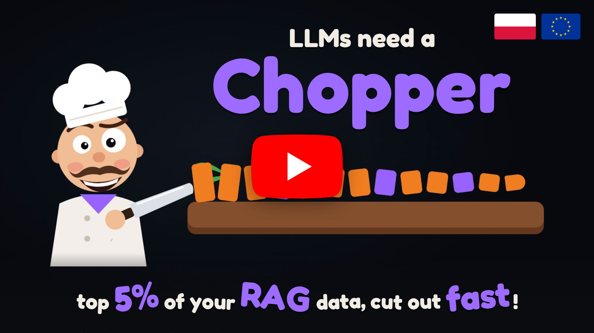
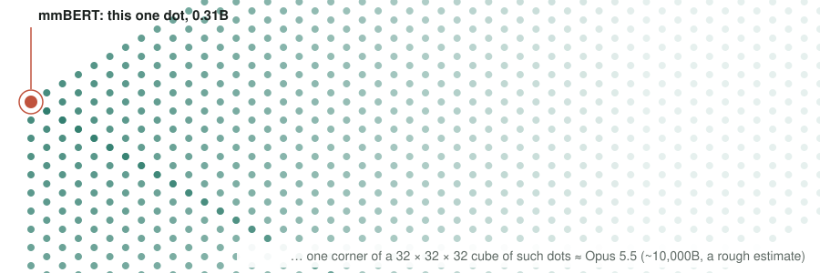
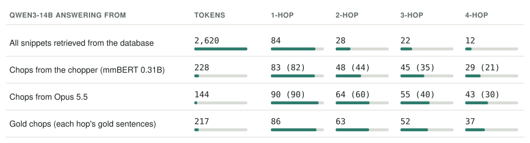
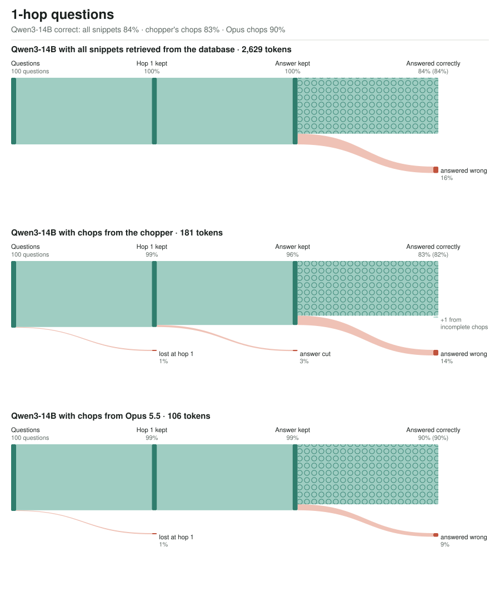
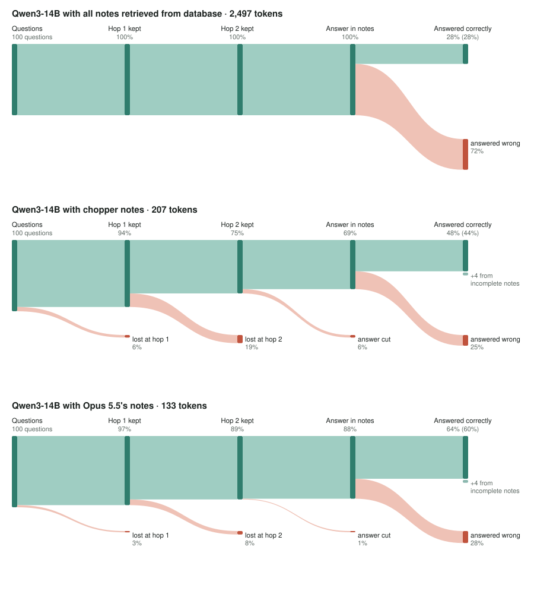
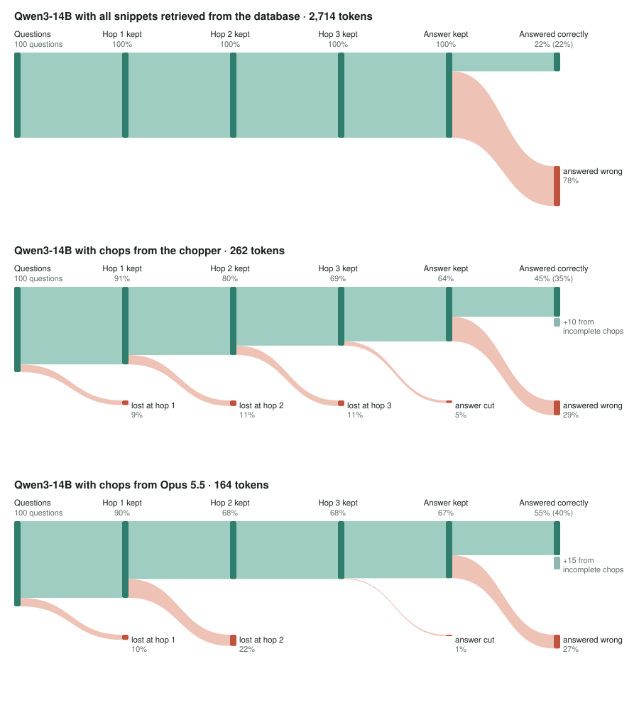
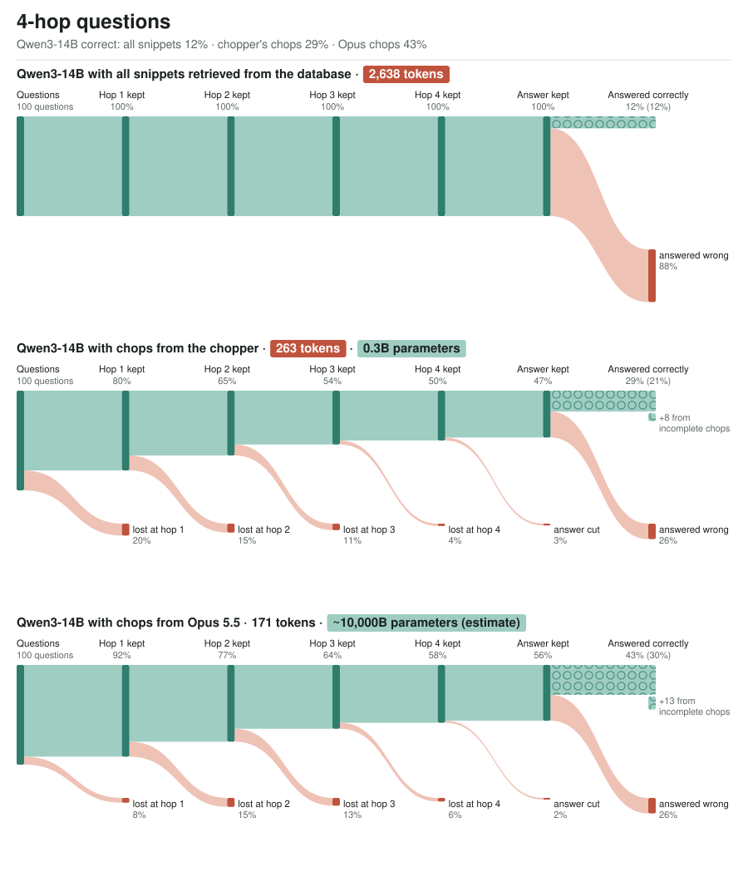

<p align="center">
  <a href="https://youtu.be/KMvmdXCEOJU"></a><br>
  <a href="#quick-start"></a>
  <a href="docs/DETAILS.md#a-host-with-latent-attention-minicpm3-4b"></a>
</p>
<p align="center"><em>70-second video: <a href="https://youtu.be/KMvmdXCEOJU">youtu.be/KMvmdXCEOJU</a></em></p>

## Chopper 0.3B close to Opus 5.5 in cutting out the best pieces

**Chops** are pieces cut out of the original text snippets retrieved from a database or a long conversation: exact quotes,
never rewritten. The chopper (mmBERT, 0.31B) makes them; for comparison, Claude Opus 5.5 makes them too, also forced to
quote directly.

> **One database retrieval per question, even at 4 hops.** Every result below uses a single retrieval: each question gets its
> 20 snippets once, the chopper cuts them once, and Qwen3-14B answers once. There are no follow-up searches and no second
> rounds, so a 4-hop question has to be chained from one cut.

### mmBERT is 32,000 times smaller

<p align="center"></p>

### Qwen3-14B answering from full snippets or just short chops

400 MuSiQue questions, 100 each at 1, 2, 3 and 4 hops, each with its own 20 retrieved snippets. Qwen3-14B (4-bit, no fine-tuning,
no thinking mode) answers from the given text only; gpt-5.6-luna judges. Length = prompt tokens. Each score counts every correct
answer, including those from incomplete chops; the number in brackets counts only questions whose chops kept every hop and the answer.

<p align="center"></p>

### Qwen3-14B: all snippets vs chops from the chopper vs chops from Opus 5.5

Read each diagram like website traffic: questions flow left to right, and at every hop the ones whose fact the chops missed drop
out; the last stage is Qwen3-14B answering correctly. Top: all 20 retrieved snippets. Middle: the chopper's chops. Bottom: Opus 5.5's chops.

<p align="center"></p>
<p align="center"></p>
<p align="center"></p>
<p align="center"></p>

The last stage is the table's score; the lighter block under it counts answers Qwen got right from incomplete chops, and the
number in brackets leaves them out. More: [docs/DETAILS.md §7](docs/DETAILS.md#7-multi-hop-where-answers-get-lost).

---

# Chopper 🔪 keep only the part of RAG that answers the question

Standard RAG (retrieval-augmented generation) pastes whole passages into your model's context, and they stay there.
**About 95% of those tokens don't help.** After a few lookups, a long session is mostly retrieval spam.

**Chopper** is a small model that reads the retrieved passages first and keeps only the fragments that matter. Your
model then sees ~100 tokens instead of ~3,000 per lookup, and a session can carry dozens of lookups.

```
question ─► retrieve 16 passages ─► 🔪 chop to ~3 fragments ─► model answers, or asks one follow-up search
```

- 🎯 **Clean context:** only useful fragments enter the session; the raw passages never stay.
- ⚡ **Less compute:** the main model reads 2–5% of the retrieved text.
- 🔗 **Multi-hop works:** the model writes a follow-up question when a fact is missing, and searches again.
- 🏠 **Built on one home GPU:** every dataset, label and model here was trained on a single RTX 3090.

## Results at a glance

| | |
|---|---|
| retrieved text the main model reads | **2–5%** (about 20–40× less); the answer is still in the kept text for 85% of HotpotQA and 69% of TriviaQA questions |
| multi-hop questions with every needed passage found (MuSiQue; earlier chopper) | **.62 → .87** with one written follow-up search |
| correct answers end to end, MuSiQue / HotpotQA / TriviaQA (judged by gpt-5.6-luna, 4B answering model; earlier chopper) | first search only .39 / .78 / .73 → **with the search loop .61 / .76 / .74** |
| "nothing here": pools whose answer was deleted (8 languages, business documents) | asks to search again **67%** of the time, keeps 1.4% of the text |
| chopping time per lookup (RTX 3090) | **155 ms** (separate mmBERT) · **277 ms** (built into MiniCPM3-4B) |
| 4-hop MuSiQue questions answered correctly by Qwen3-14B, one retrieval | **12% → 29%** with the chopper's chops instead of all 20 snippets (11× fewer tokens); with Opus 5.5's chops: 43% |

Long-conversation memory results (LoCoMo, LongMemEval) are in
[the details](docs/DETAILS.md#6-long-conversation-memory-locomo-and-longmemeval): there the 4B answering model is the limit.

## Pick your chopper

| | 🟧 **universal** | 🟪 **integrated** |
|---|---|---|
| what it is | a separate small encoder (mmBERT-base, 0.31B, recommended; or mmBERT-small, 0.14B) | a 20% slice of MiniCPM3-4B's own weights + a small LoRA |
| works with | **any** answering model: text in, text out | MiniCPM3-4B |
| extra memory | 0.31B / 0.14B weights | 45M parameters; reads the model's own cache |
| weights | 🤗 [`wiiiktor/chopper_mmbert`](https://huggingface.co/wiiiktor/chopper_mmbert) | 🤗 [`wiiiktor/chopper_minicpm3`](https://huggingface.co/wiiiktor/chopper_minicpm3) |

Start with the universal one. The integrated one is the long-term bet: trained together with a model from the start, it
should become almost free. **If you pretrain models and want to build that, contact
[wiiiktor](https://github.com/wiiiktor).**

## Quick start

```bash
pip install -r requirements.txt

# your documents (a folder of .txt / .md, or a .jsonl with "title" and "text") + any Hugging Face causal LM
python operator-for-llm-with-mmbert.py --docs my_docs/ --model <hf model id> \
       --ask "Who founded the company that distributed the film UHF?"

# leave out --ask for an interactive session; it shows how many tokens plain RAG would have added
```

Weights download from Hugging Face on first use. Training data: 🤗 [`wiiiktor/chopper_demo`](https://huggingface.co/datasets/wiiiktor/chopper_demo).

## Want the details?

Everything else is on one page, **[docs/DETAILS.md](docs/DETAILS.md)**:
- [how it works](docs/DETAILS.md#how-it-works): double prefill, rollback, the answer-or-search decision;
- [datasets](docs/DETAILS.md#datasets) and [training](docs/DETAILS.md#training-hardware-time-memory) on one GPU;
- [all results](docs/DETAILS.md#results), including the [search loop](docs/DETAILS.md#3-second-retrieval-with-a-written-follow-up-question)
  and the [8-language rerank pilot](docs/DETAILS.md#5-rerank-pilot-8-languages-business-documents-no-answer-here);
- [rewiring a model into its own chopper](docs/DETAILS.md#rewiring) and [what comes next](docs/DETAILS.md#further-development);
- [credits, licenses and related work](docs/DETAILS.md#credits-and-licenses).

## Credits

Built on mmBERT (JHU CLSP), MiniCPM3-4B (OpenBMB), Qwen3 and Qwen3-Embedding (Qwen team), bge-reranker (BAAI), and the
MuSiQue, HotpotQA, 2WikiMultiHopQA, TriviaQA, QASPER, Multi-Session Chat, WildChat, FineWeb, Wikipedia, LoCoMo and
LongMemEval datasets. Our memory evaluation follows
[Memory Tax](https://arxiv.org/abs/2610.34073) (He et al., 2026) and compares with
[MemT-1.0](https://arxiv.org/abs/2610.26825) (MemTensor, 2026). Full table with licenses:
[docs/DETAILS.md](docs/DETAILS.md#credits-and-licenses).
