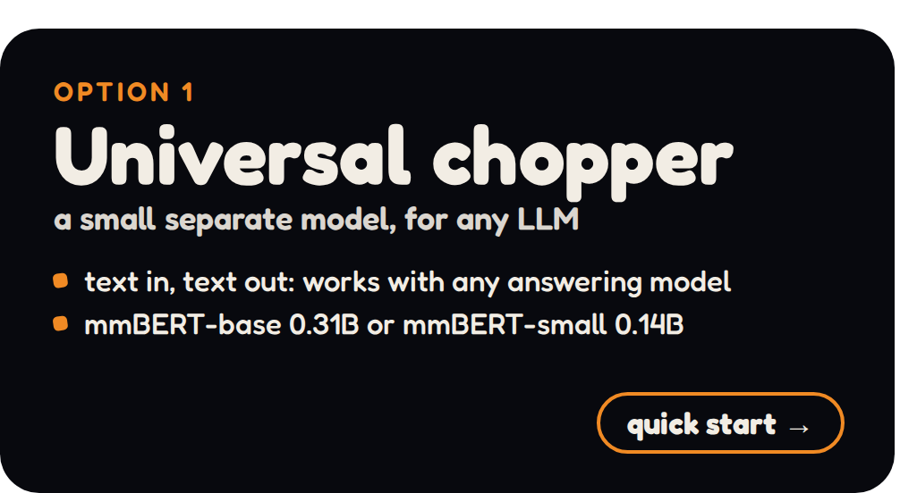
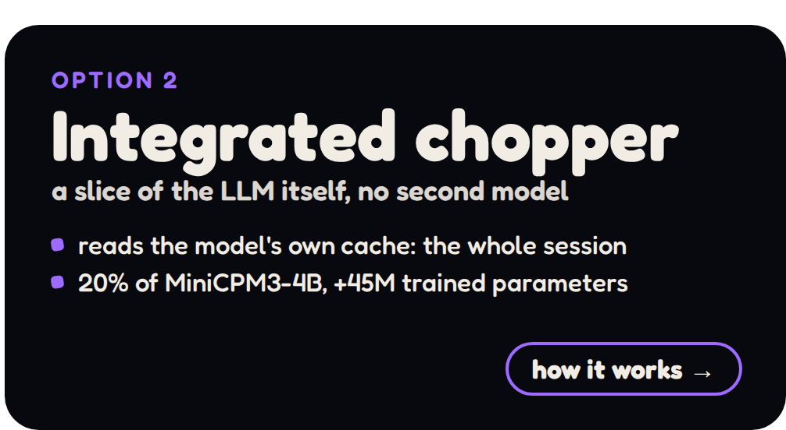
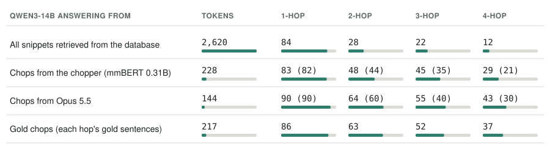
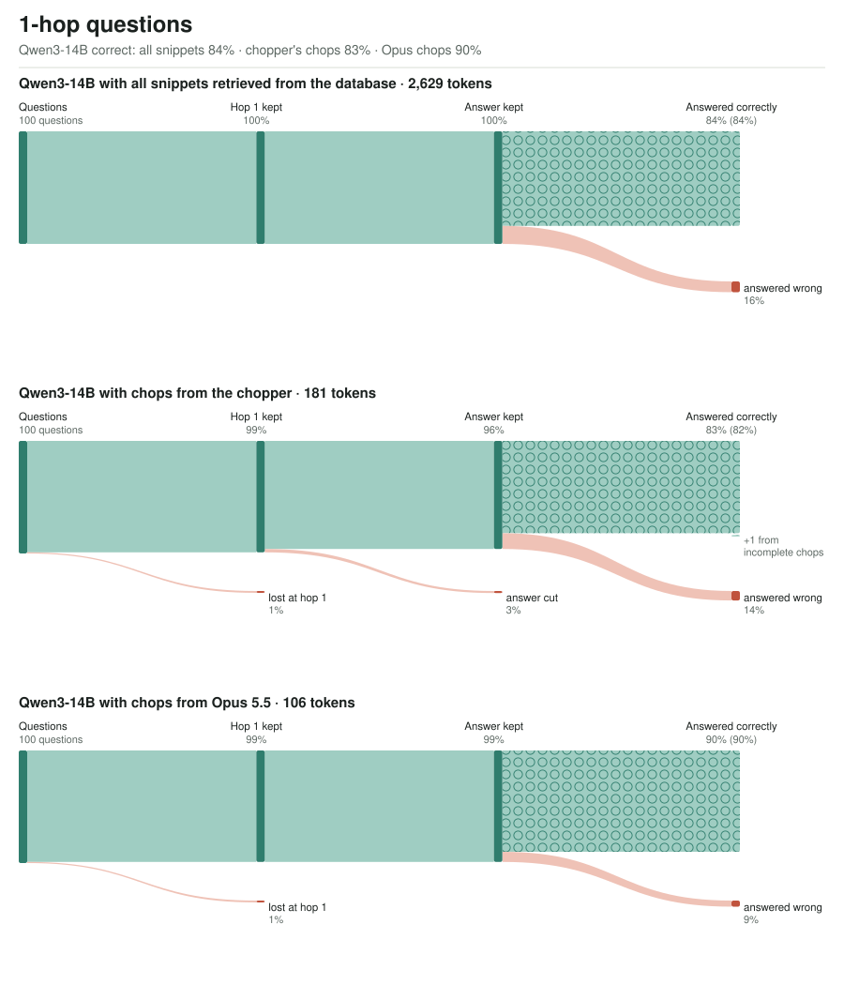
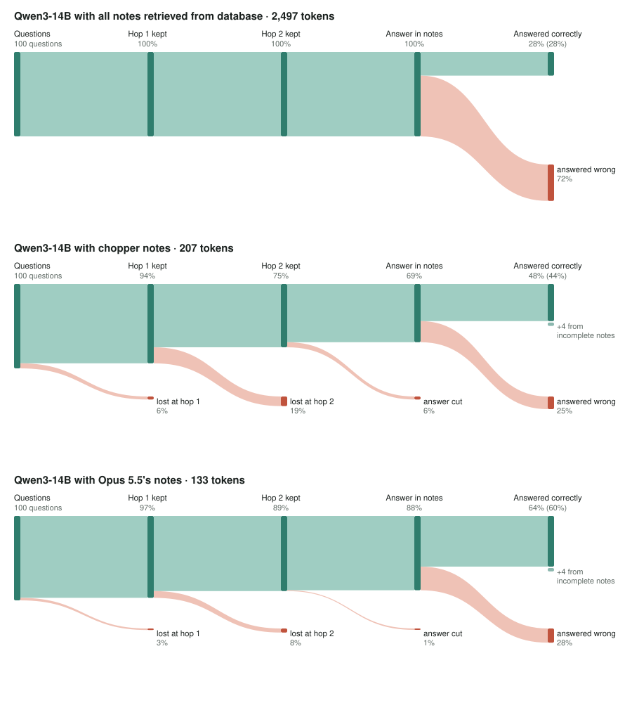
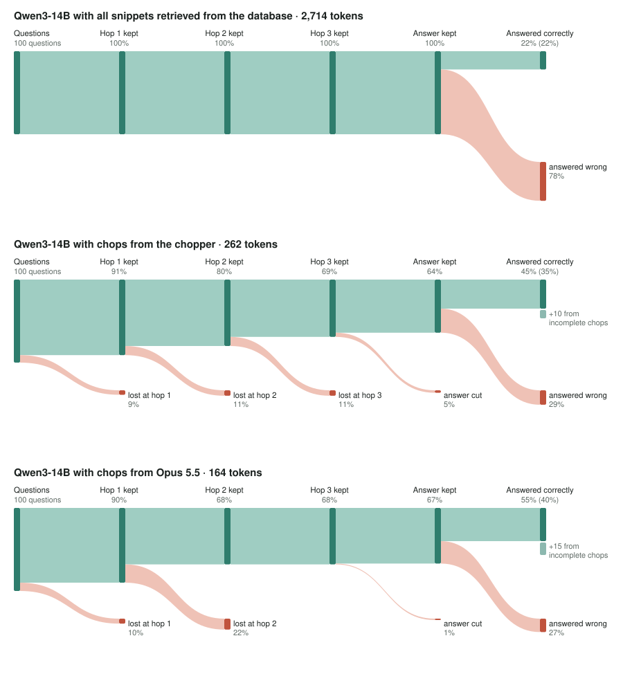
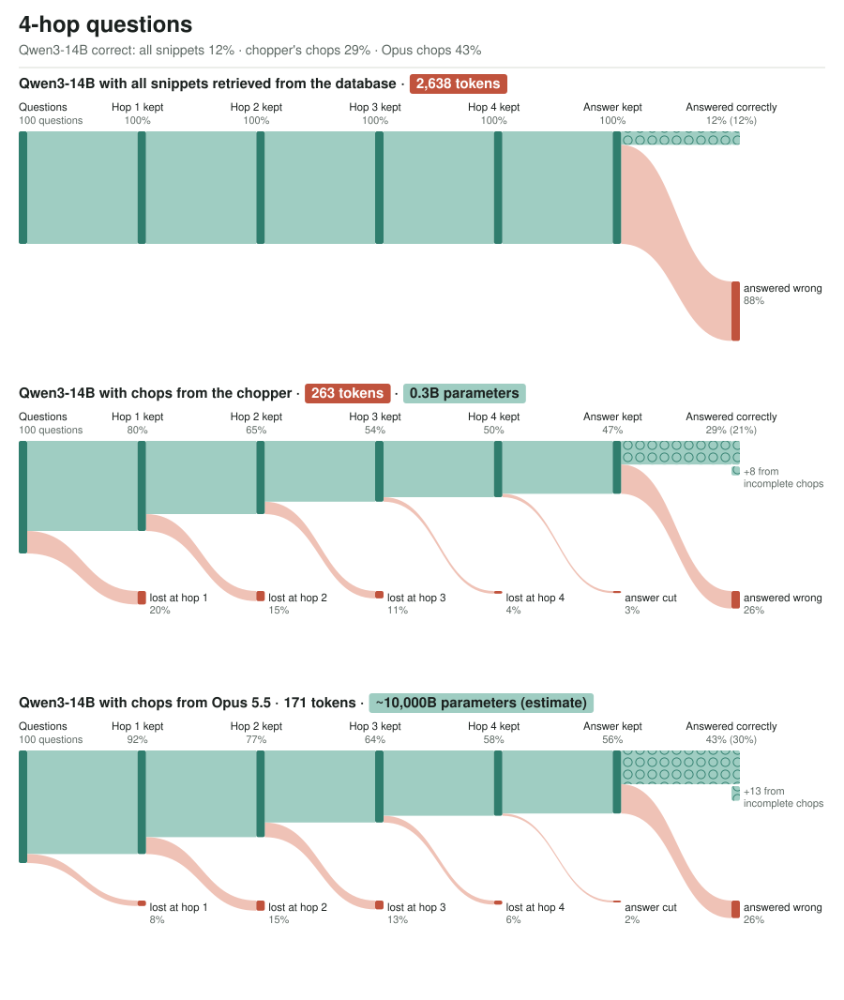
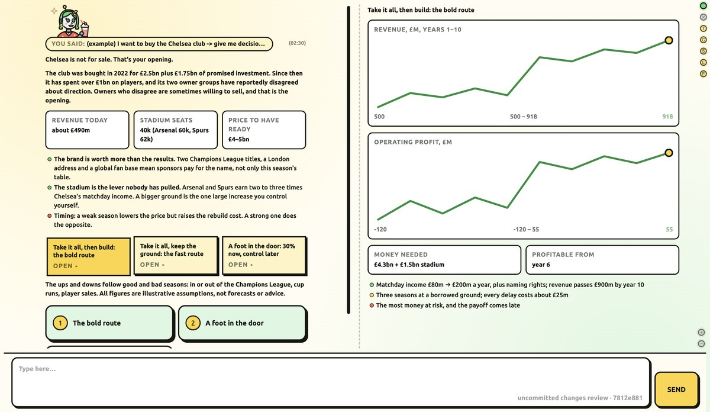

<p align="center">
  <a href="https://youtu.be/KMvmdXCEOJU"></a><br>
  <a href="#quick-start"></a>
  <a href="docs/DETAILS.md#a-host-with-latent-attention-minicpm3-4b"></a>
</p>
<p align="center"><em>70-second video: <a href="https://youtu.be/KMvmdXCEOJU">youtu.be/KMvmdXCEOJU</a></em></p>
<p align="center"><b>Try it in your browser, nothing to install:</b> <a href="https://huggingface.co/spaces/wiiiktor/chopper">English demo</a> · <a href="https://huggingface.co/spaces/wiiiktor/chopper-pl">Polish demo</a><br><em>They run the recommended <b>base</b> chopper (0.31B) on your CPU, with <b>small</b> (0.14B) as a faster option.</em></p>
<p align="center"><b>See it on real examples:</b> <a href="examples/chopper_vs_opus_20_examples_en.pdf">20 English questions, Chopper vs Opus 5.5 vs gold (PDF)</a></p>

> **Where this is going.** The standalone chopper is a first, practical step. The main idea is an **integrated chopper**: chopping built into the answering LLM itself, reading the model's own cache of the session instead of re-encoding the text in a second model, which should give the highest possible quality and speed. A proof of concept with MiniCPM3-4B is described [here](docs/DETAILS.md#a-host-with-latent-attention-minicpm3-4b).

## Chopper 0.3B close to Opus 5.5 in cutting out the best pieces

**Chops** are pieces cut out of the original text snippets retrieved from a database or a long conversation: exact quotes,
never rewritten. The chopper (mmBERT, 0.31B) makes them; for comparison, Claude Opus 5.5 makes them too, also forced to
quote directly.

> **What is new:** a new method, invented in November 2026 in Poland (EU). The chopper is not an LLM summarising the snippets:
> a small encoder reads the question and all 20 snippets together in **one pass** and marks every word keep or drop. There is no
> text generation, so it is fast: **50 ms per question** (20 snippets, ~2,400 tokens) on a consumer-grade GPU (RTX 3090), 36 ms with mmBERT-small.

> **One database retrieval per question, even at 4 hops.** Every result below uses a single retrieval: each question gets its
> 20 snippets once, the chopper cuts them once, and Qwen3-14B answers once. There are no follow-up searches and no second
> rounds, so a 4-hop question has to be chained from one cut.

### A reranker that also gives you the chops

<p align="center"></p>

One model replaces both the reranker and the compressor. Full comparison: [below](#also-a-reranker-ranking-and-chopping-in-one-pass).

### Qwen3-14B answering from full snippets or just short chops

400 MuSiQue questions, 100 each at 1, 2, 3 and 4 hops, each with its own 20 retrieved snippets. Qwen3-14B (4-bit, no fine-tuning,
no thinking mode) answers from the given text only; gpt-5.6-luna judges. Length = prompt tokens. Each score counts every correct
answer, including those from incomplete chops; the number in brackets counts only questions whose chops kept every hop and the answer.

<p align="center"></p>

### Qwen3-14B: all snippets vs chops from the chopper vs chops from Opus 5.5

Read each diagram like website traffic: questions flow left to right, and at every hop the ones whose fact the chops missed drop
out; the last stage is Qwen3-14B answering correctly. Top: all 20 retrieved snippets. Middle: the chopper's chops. Bottom: Opus 5.5's chops.

<p align="center"></p>
<p align="center"></p>
<p align="center"></p>
<p align="center"></p>

The last stage is the table's score; the lighter block under it counts answers Qwen got right from incomplete chops, and the
number in brackets leaves them out. More: [docs/DETAILS.md §7](docs/DETAILS.md#7-multi-hop-where-answers-get-lost).

### Also a reranker: ranking and chopping in one pass

The chopper scores every passage while it chops (mean p(KEEP) of the passage's 16 most likely tokens). On the
8-language rerank holdout (400 queries, 16 passages each, never trained on), ranked against dedicated rerankers:

| ranking 16 passages | nDCG@10 | Hit@1 | GPU time per query (RTX 3090) |
|---|---|---|---|
| **chopper, mmBERT-base (0.31B), one pass** | **0.973** | **0.972** | **0.20 s**, chops + ANSWER/SEARCH included |
| [bge-reranker-v2-m3](https://huggingface.co/BAAI/bge-reranker-v2-m3) (0.57B) | 0.984 | 0.985 | 0.20 s |
| [Qwen3-Reranker-0.6B](https://huggingface.co/Qwen/Qwen3-Reranker-0.6B) | 0.977 | 0.972 | 0.77 s |
| [Qwen3-Reranker-4B](https://huggingface.co/Qwen/Qwen3-Reranker-4B) | 0.986 | 0.990 | 3.3 s |

The chopper was never trained to rank, yet it is within about one point of the best rerankers at the speed of the fastest,
so a pipeline can drop its reranker: `retrieve → chopper` gives the ranking *and* the quotes. Caveats (this test is easy
for every model; the labels favour Qwen3-Reranker-0.6B) in [the details](docs/DETAILS.md#the-chopper-as-a-reranker).

### Against other context compressors

Same 400 questions, same 20 snippets, same Qwen3-14B prompt; each compressor cuts the snippets once:

| Qwen3-14B answering from | tokens | 1-hop | 2-hop | 3-hop | 4-hop |
|---|---|---|---|---|---|
| all 20 snippets (no compression) | 2,620 | 84 | 28 | 22 | 12 |
| [LLMLingua-2](https://huggingface.co/microsoft/llmlingua-2-xlm-roberta-large-meetingbank) (Microsoft), rate 0.1 | 374 | 28 | 6 | 2 | 4 |
| [Provence](https://huggingface.co/naver/provence-reranker-debertav3-v1) (Naver), its default threshold 0.1 | 263 | 77 | 27 | 26 | 16 |
| Provence, threshold 0.5 | 152 | 71 | 24 | 21 | 11 |
| **chops from the chopper, mmBERT-small (0.14B)** | 217 | 72 | **49** | 32 | 23 |
| **chops from the chopper, mmBERT-base (0.31B)** | 228 | **83** | 48 | **45** | **29** |

LLMLingua-2 drops tokens without looking at the question, so the facts a chain needs rarely survive. Provence reads the question
but prunes each snippet on its own. **To be fair to them:** the chopper was trained on MuSiQue's train split (this test uses
its dev split) and on other multi-hop data, while both were trained for general single-passage use.


### Against XProvence on its own benchmark

[XProvence](https://huggingface.co/naver/xprovence-reranker-bgem3-v2) (Naver, 2026) prunes each retrieved passage to the relevant
sentences and is built on bge-reranker-v2-m3. We re-ran **its own evaluation**: its questions, its retrieved documents, its prompts
and its metric (share of the gold answer's character 3-grams found in the answer), 150 questions per set, with Qwen3-14B and with
the paper's own answer model aya-expanse-8b (our no-pruning aya scores match the paper's within 0.01 on MKQA, TyDi QA and XPQA).

| Qwen3-14B answering, score (share of the text removed) | MKQA, 10 languages | TyDi QA | XPQA, 7 languages | MedExpQA |
|---|---|---|---|---|
| all documents | 0.462 | 0.754 | 0.376 | 0.940 |
| **Chopper, whole sentences** | **0.400** (90%) | **0.693** (92%) | **0.286** (87%) | 0.698 (97%) |
| XProvence, threshold 0.7 | 0.402 (85%) | 0.683 (84%) | 0.211 (99.6%) | 0.695 (99%) |
| XProvence, threshold 0.3 | 0.443 (58%) | 0.728 (71%) | 0.295 (78%) | 0.845 (52%) |
| XProvence, threshold 0.1 (default) | 0.455 (36%) | 0.737 (57%) | 0.369 (23%) | 0.930 (8%) |
| LLMLingua-2, rate 0.33 | 0.408 (65%) | 0.576 (67%) | 0.307 (64%) | 0.847 (64%) |

- **At the same aggressive cut** (85–90% of the text removed), Chopper ties or beats XProvence; with aya-expanse-8b too
  (MKQA 0.414 vs 0.415, TyDi QA 0.712 vs 0.712; on XPQA XProvence's 0.7 setting removes 99.6%, so the fair pair is its 0.3
  setting: 0.410 vs 0.407, removing 87% vs 78%). It is also **~5× faster** (0.03 s vs 0.17 s per question).
- **XProvence is better at light trimming**: at its default it removes only 23–57% and stays near full accuracy. Chopper always
  keeps a few quotes, which costs 6–9 points against reading everything; on MedExpQA (one long explanation per question) it cuts
  away what the answer needs.
- **As a reranker XProvence is still ahead** (nDCG@10 0.985 vs 0.974 on our 8-language holdout). A Chopper on
  **bge-reranker-v2-m3** (XProvence's own base, Apache 2.0) is in training to improve Chopper as a reranker, so this gap will
  probably close.
- **License:** XProvence is CC BY-NC-ND 4.0 (non-commercial); Chopper is MIT. Full tables, aya results and method:
  [DETAILS](docs/DETAILS.md#chopper-vs-xprovence-provence-and-llmlingua-2).
---

# Chopper 🔪 keep only the part of RAG that answers the question

Standard RAG (retrieval-augmented generation) pastes whole passages into your model's context, and they stay there.
**About 95% of those tokens don't help.** After a few lookups, a long session is mostly retrieval spam.

**Chopper** is a small model that reads the retrieved passages first and keeps only the fragments that matter. Your
model then sees ~100 tokens instead of ~3,000 per lookup, and a session can carry dozens of lookups.

```
question ─► retrieve 16 passages ─► 🔪 rank + chop in one pass ─► model answers, or asks one follow-up search
```

- 🎯 **Clean context:** only useful fragments enter the session; the raw passages never stay.
- ⚡ **Less compute:** the main model reads 2–5% of the retrieved text.
- 🏅 **Also a reranker:** the same pass ranks the passages almost as well as bge-reranker-v2-m3 (nDCG@10 0.973 vs 0.984, 8 languages), at the same speed. No separate reranker needed.
- 🔗 **Multi-hop works:** the model writes a follow-up question when a fact is missing, and searches again.
- 🏠 **Built on one home GPU:** every dataset and model here was made on a single RTX 3090 (some labels came from APIs).

## Results at a glance

| | |
|---|---|
| retrieved text the main model reads | **2–5%** (about 20–40× less); the answer is still in the kept text for 85% of HotpotQA and 69% of TriviaQA questions |
| "nothing here": pools whose answer was deleted (8 languages, business documents) | asks to search again **67%** of the time, keeps 1.4% of the text |
| ranking 16 passages (8-language holdout, 400 queries) | nDCG@10 **0.973**, vs bge-reranker-v2-m3 0.984 and Qwen3-Reranker-4B 0.986; 0.20 s like bge, 16× faster than Qwen-4B, chops included ([details](docs/DETAILS.md#the-chopper-as-a-reranker)) |
| chopping time per lookup (RTX 3090) | **155 ms** (separate mmBERT) · **277 ms** (built into MiniCPM3-4B) |
| 4-hop MuSiQue questions answered correctly by Qwen3-14B, one retrieval | **12% → 29%** with the chopper's chops instead of all 20 snippets (11× fewer tokens); with Opus 5.5's chops: 43% |
| Polish questions (PoQuAD, PolQA) answered correctly by Qwen3-14B | **85.6%** from the Polish chopper's chops (255 tokens) vs 85.2% from all 16 snippets (3,856 tokens) |
| license | **MIT**: free for commercial use, weights and code. The closest alternatives, Provence and XProvence (Naver, sentence pruning + reranking), are CC BY-NC-ND 4.0: non-commercial only |

*All quality numbers in this repository (F1, recall, answer accuracy, nDCG) were measured on **raw chops, without word or sentence snapping**. Since `chopper-rag` 0.1.7 the package extends chops to whole sentences by default (97% of chops then end at a sentence end, vs 36% raw; about 4.1% of the text kept instead of 3.4%; [details](integrations/chopper-rag/README.md#whole-sentences-by-default-snap)).*

*Polish (Nov 2026), suggested by the OPI PIB AI Lab:* the same recipe on OPI PIB's [pl-ModernBERT-base](https://huggingface.co/OPI-PIB/pl-ModernBERT-base), plus a Polish multi-hop stage (MuSiQue translated to Polish), is the best chopper for Polish documents: the Polish default `Chopper.from_pretrained(variant="base-pl")` since chopper-rag 0.1.9 (Apache 2.0). On 100 Polish two-hop questions Qwen3-14B answers **56%** from its chops vs 43% with mmBERT-base-pl and 33% from all 20 paragraphs; KEEP F1 0.694 vs 0.562 (PoQuAD) and 0.731 vs 0.647 (PolQA); 86.2% vs 85.5% of 856 Polish questions, with 30% fewer tokens per pool. mmBERT-base-pl still ranks Polish passages slightly better (nDCG@10 0.953 vs 0.939) and stays available as `variant="mmbert-base-pl"` for mixed-language text (pl-ModernBERT's tokenizer is Polish-only). The [Polish demo](https://huggingface.co/spaces/wiiiktor/chopper-pl) now uses it. [polish-roberta-base-8k](https://huggingface.co/sdadas/polish-roberta-base-8k) follows. Details: [docs/DETAILS.md](docs/DETAILS.md#polish-bases-results).

Long-conversation memory results (LoCoMo, LongMemEval) are in
[the details](docs/DETAILS.md#6-long-conversation-memory-locomo-and-longmemeval): there the 4B answering model is the limit.

## Pick your chopper

| | 🟧 **universal** | 🟪 **integrated** |
|---|---|---|
| what it is | a separate small encoder (mmBERT-base, 0.31B, recommended; or mmBERT-small, 0.14B; both also in Polish versions) | a 20% slice of MiniCPM3-4B's own weights + a small LoRA |
| works with | **any** answering model: text in, text out | MiniCPM3-4B |
| extra memory | 0.31B / 0.14B weights | 45M parameters; reads the model's own cache |
| weights | 🤗 [`wiiiktor/chopper_mmbert`](https://huggingface.co/wiiiktor/chopper_mmbert) | 🤗 [`wiiiktor/chopper_minicpm3`](https://huggingface.co/wiiiktor/chopper_minicpm3) |

Start with the universal one. The integrated one is the long-term bet: trained together with a model from the start, it
should become almost free. **If you pretrain models and want to build that, contact
[wiiiktor](https://github.com/wiiiktor).**

## Quick start

No install: try the [in-browser demo](https://huggingface.co/spaces/wiiiktor/chopper) ([po polsku](https://huggingface.co/spaces/wiiiktor/chopper-pl)). It runs `base` (0.31B) by default, like the code below, or `small` (0.14B).

In your own RAG pipeline (LangChain, LlamaIndex, Haystack or plain Python):

```bash
pip install chopper-rag                  # or "chopper-rag[langchain]", [llama-index], [haystack], [all]
```

As a tool for Claude (Claude Code, Claude Desktop or any MCP client): `pip install "chopper-rag[mcp]"`, then
`claude mcp add chopper -- chopper-mcp`. Claude can then call `chop_passages` / `chop_files` to read a few quotes
instead of whole documents, or `rank_passages` to rerank; setup in [integrations/chopper-rag](integrations/chopper-rag#mcp-server-claude-desktop-claude-code-any-mcp-client).

<a href="https://mcprush.com/wiiiktor/chopper-mcp"></a>

```python
from chopper_rag import Chopper
chopper = Chopper.from_pretrained(variant="base")          # or "small"; for Polish "base-pl" (pl-ModernBERT), "mmbert-base-pl", "small-pl"
result = chopper.run("When was the Eiffel Tower completed?", passages)   # passages: list of retrieved texts
print([c.text for c in result.chops], result.decision)    # exact quotes + ANSWER / SEARCH
print(result.ranking(top_k=5))                             # the same pass as a reranker: [(passage_index, relevance), ...]
```

Framework examples: [integrations/chopper-rag](integrations/chopper-rag/README.md). Listed in the
[LangChain integrations](https://docs.langchain.com/oss/python/integrations/providers/all_providers) (ChopperCompressor). Or try the demo in this repo:

```bash
pip install -r requirements.txt

# your documents (a folder of .txt / .md, or a .jsonl with "title" and "text") + any Hugging Face causal LM
python operator-for-llm-with-mmbert.py --docs my_docs/ --model <hf model id> \
       --ask "Who founded the company that distributed the film UHF?"

# leave out --ask for an interactive session; it shows how many tokens plain RAG would have added
```

Weights download from Hugging Face on first use. Training data: 🤗 [`wiiiktor/chopper_demo`](https://huggingface.co/datasets/wiiiktor/chopper_demo).

## Want the details?

Everything else is on one page, **[docs/DETAILS.md](docs/DETAILS.md)**:
- [how it works](docs/DETAILS.md#how-it-works): double prefill, rollback, the answer-or-search decision;
- [datasets](docs/DETAILS.md#datasets) and [training](docs/DETAILS.md#training-hardware-time-memory) on one GPU;
- [all results](docs/DETAILS.md#results), including the [search loop](docs/DETAILS.md#3-second-retrieval-with-a-written-follow-up-question)
  and the [8-language rerank pilot](docs/DETAILS.md#5-rerank-pilot-8-languages-business-documents-no-answer-here);
- [rewiring a model into its own chopper](docs/DETAILS.md#rewiring) and [what comes next](docs/DETAILS.md#further-development);
- [credits, licenses and related work](docs/DETAILS.md#credits-and-licenses).

## Credits

Built on mmBERT (JHU CLSP), MiniCPM3-4B (OpenBMB), Qwen3, Qwen3-Embedding and Qwen3-Reranker (Qwen team), bge-reranker (BAAI);
labels and judgements also came from Claude Opus 5.5 (Anthropic) and gpt-5.6-luna / GPT-6 Luna (OpenAI). Compared with
LLMLingua-2 (Microsoft) and Provence (Naver). Data: the MuSiQue, HotpotQA, 2WikiMultiHopQA, TriviaQA, QASPER, Multi-Session Chat, WildChat, FineWeb, Wikipedia, LoCoMo and
LongMemEval datasets; for Polish, PoQuAD and [PolQA](https://aclanthology.org/2024.lrec-main.1125) (IPI PAN). Our memory evaluation follows
[Memory Tax](https://arxiv.org/abs/2610.34073) (He et al., 2026) and compares with
[MemT-1.0](https://arxiv.org/abs/2610.26825) (MemTensor, 2026). Full table with licenses:
[docs/DETAILS.md](docs/DETAILS.md#credits-and-licenses).

## Licenses

**Commercial use is allowed.** The mmBERT choppers and all code are MIT. For comparison, Naver's Provence and XProvence context pruners are licensed CC BY-NC-ND 4.0 (no commercial use, no derivatives).

| what | license |
|---|---|
| mmBERT choppers, incl. Polish (`mmbert-base`, `mmbert-small`, `mmbert-base-pl`, `mmbert-small-pl`) | MIT (as mmBERT) |
| Polish chopper on pl-ModernBERT-base (`plmodernbert-base`, package variant `base-pl`) | Apache 2.0 (as pl-ModernBERT) |
| code in this repo ([LICENSE](LICENSE)) and `pip install chopper-rag` | MIT |
| MiniCPM3 chopper | [MiniCPM Model License](https://github.com/OpenBMB/MiniCPM/blob/main/MiniCPM%20Model%20License.md) (as MiniCPM3-4B) |
| training data [`wiiiktor/chopper_demo`](https://huggingface.co/datasets/wiiiktor/chopper_demo) | CC BY-SA 4.0 (share-alike from HotpotQA, Wikipedia and PolQA); Polish parts: PoQuAD CC BY 4.0, PolQA CC BY-SA 4.0 |

Some labels came from Claude Opus 5.5 and OpenAI Luna models, used to train a non-competing extraction tool;
see [docs/DETAILS.md](docs/DETAILS.md#credits-and-licenses).

---

**Bored with reading LLMs' outputs?** See also my other project, [**control_room**](https://github.com/wiiiktor/control_room):
a VS Code panel for Claude Code that shows each answer as cards, charts and clickable options instead of a wall of text.

<p align="center"><a href="https://github.com/wiiiktor/control_room"></a></p>
